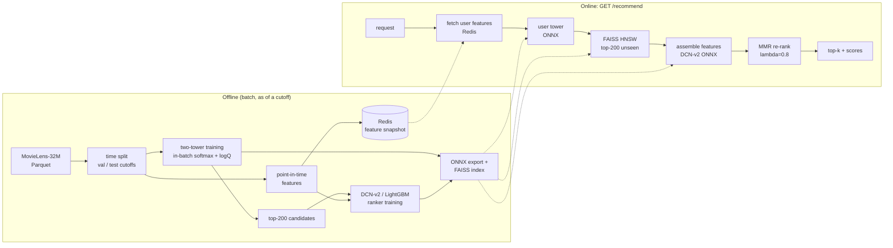

# sysrec: a multi-stage recommender system on MovieLens-32M

A production-style recommender built the way large platforms structure it:
**two-tower retrieval + ANN -> DCN-v2 multi-task ranking -> MMR diversity re-ranking -> low-latency
serving**, with a leakage-free, time-based offline evaluation harness and a simulated A/B test.
Every number below comes from a script in this repo that wrote raw results to `results/*.json`
(with dataset checksum, split, seed, hardware, library versions and git commit).

> **Hardware.** All training and latency numbers were measured on a cloud VM: Intel Xeon @ 2.1 to 2.3 GHz,
> **4 vCPU, 15.7 GB RAM, no GPU**, Ubuntu 24.04. They are CPU numbers. The code picks CUDA, then
> Apple MPS, then CPU (`recsys/utils/device.py`), so it runs unchanged on an M-series Mac.

## Architecture



Unknown users get recent-popular (or genre-popular with `?genres=`) items. `/metrics` exposes
Prometheus histograms of latency per stage.

## Results

**Evaluation protocol.** Global time split: train before 2023-04-01, validation 2023-04-01 to
2023-07-01, test 2023-07-01 to 2023-10-13. Models are scored on users with >= 1 positive
(rating >= 4) in the window, against the **full 87,585-item catalog**, excluding anything the user
already rated. Everything is tuned on val; test numbers use models refit on all data before the test
window. Details: `docs/data.md`, `docs/design.md`.

**Offline replay A/B on the test window** (`results/m6_ab_sim.json`; 4,726 users; 95% bootstrap CIs over users):

| variant | NDCG@10 | Recall@10 | HitRate@10 | intra-list diversity |
|---|---|---|---|---|
| A recent-popular (30 days) | 0.172 [0.165, 0.178] | 0.076 [0.072, 0.081] | 0.481 | 0.369 |
| B ALS | 0.159 [0.153, 0.166] | 0.067 [0.063, 0.071] | 0.465 | 0.383 |
| C two-tower retrieval only | 0.162 [0.155, 0.168] | 0.070 [0.066, 0.074] | 0.477 | 0.313 |
| D two-tower + DCN-v2 ranker | **0.210** [0.203, 0.218] | **0.098** [0.093, 0.103] | 0.553 | 0.300 |
| E D + MMR re-ranking | **0.210** [0.203, 0.218] | **0.098** [0.093, 0.103] | 0.553 | 0.321 |

Paired bootstrap: D vs A **+22.5% NDCG@10** (p < 0.001); E vs D: NDCG change -0.0003, CI
[-0.0009, 0.0005] (not significant) for +7% diversity. **This is an offline replay, not a live A/B
test**: it can't see feedback loops, position bias, or how users react to diversity.

**Retrieval** (test, `results/m2_*.json`, `results/m1_baselines.json`): two-tower Recall@100
**0.298** vs ALS 0.279 vs recent-popular 0.284. logQ correction is essential: without it Recall@100
falls to 0.132. FAISS HNSW (efSearch 128) keeps 98.8% of exact top-100 at 0.07 ms vs 0.85 ms
for exact search per query (`docs/figures/faiss_tradeoff.png`).

**Serving** (`results/m5_latency.json`, `results/m5_parity.json`; Docker Compose on the 4-vCPU VM,
open-loop load generator on the same VM):

| config | sustained | p50 / p95 / p99 |
|---|---|---|
| baseline (1 worker, item features from Redis) | 100 req/s (saturates ~119) | 9.1 / 24.6 / 37.8 ms |
| + in-process item-feature cache | 200 req/s | 11.2 / 46.8 / 79.7 ms |
| + 3 workers, 1 BLAS thread each | **300 req/s** | **5.7 / 12.6 / 19.6 ms** |

Online lists match the offline pipeline for **300/300** sampled users with exact retrieval (99% with HNSW).

## Run it

```bash
uv venv --python 3.11 && source .venv/bin/activate && uv pip install -r requirements.txt
python scripts/env_check.py
scripts/reproduce.sh            # every step in order; a few hours on 4 vCPU (each results file records its wall time)
```

Serving only (after `scripts/build_serving.py` has produced `artifacts/serving/`):

```bash
docker compose up --build       # redis + one-shot loader + api on :8000
curl "localhost:8000/recommend?user_id=1347&k=10"
curl "localhost:8000/recommend?user_id=123456789&k=10&genres=Comedy,Horror"   # cold start
SERVICE_URL=http://localhost:8000 pytest -m integration
python benchmarks/load_test.py --label mytest --rates 50 100 200
```

Measured footprint of the running stack (default 3 API workers): Redis 390 MB of features
(200,948 users + 87,585 items), API container 841 MB, so Docker Desktop's default memory limit on a
16 GB Mac is enough. Images build natively for `linux/arm64` there. Unit tests (`pytest`) run on a tiny synthetic
dataset in seconds and in CI.

## Repo map

| path | what |
|---|---|
| `recsys/data` | Parquet prep, time split, synthetic data |
| `recsys/eval` | metrics, harness, bootstrap |
| `recsys/retrieval` | baselines, two-tower, training loop, FAISS |
| `recsys/features` | point-in-time features, MiniLM text embeddings |
| `recsys/ranking` | ranking data, LightGBM LambdaRank, DCN-v2 |
| `recsys/rerank` | MMR + genre cap |
| `recsys/serving` | snapshot export, Redis loader, engine, FastAPI app |
| `scripts/` | one script per pipeline step; `benchmarks/` load test and plots |
| `docs/` | `design.md` (decisions and trade-offs), `code-walkthrough.md`, `interview-prep.md`, `resume-bullets.md`, `data.md` |

## Limitations

- Offline replay only; MovieLens ratings are not clicks or watches, and the logged data reflects the
  site's own recommender.
- Evaluation windows are small (about 4 to 5k users per quarter), hence the CIs.
- Retrieval covers only 42% of test positives in its top 200; the ranker can't recover the rest.
- The two-tower model has no explicit notion of time or trends; the ranker supplies that through
  popularity-trend features.
- The multi-task rating head did not improve ranking (val chose weight 0); see `docs/design.md` (M3).
- Latency numbers are from a shared 4-vCPU VM with the load generator co-located.

## Future work

SASRec-style sequential user tower; time-aware retrieval (recency features in the user tower);
a candidate mixer (two-tower + recent-popular + ALS) to raise candidate recall; streaming feature
updates; a real online experiment.
