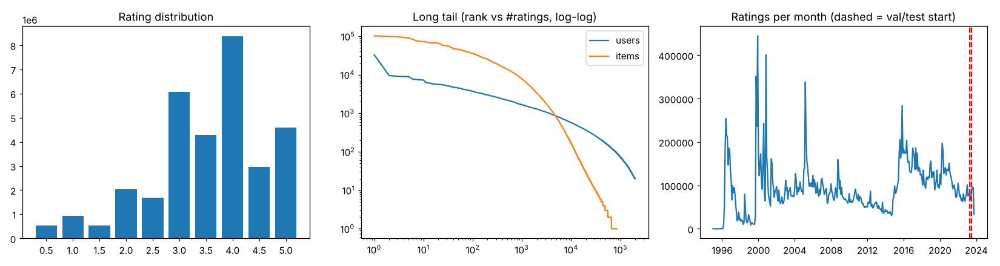

# Data report: MovieLens-32M

Generated by `python scripts/data_report.py` (raw numbers in `results/m0_data_report.json`).

| | |
|---|---|
| Interactions | 32,000,204 |
| Users | 200,948 |
| Items with >= 1 rating | 84,432 (catalog in movies.csv: see items.parquet) |
| Sparsity | 0.99811 |
| Positive fraction (rating >= 4.0) | 0.498 |
| Time range | 1995-01-09 11:46 UTC to 2023-10-13 02:29 UTC |
| Median / p90 / p99 ratings per user | 73 / 364 / 1290 |
| Median / p90 / p99 ratings per item | 5 / 249 / 9263 |
| Share of interactions on top 1% of items | 0.548 |

## Time-based split

Cutoffs live in `configs/default.yaml` (`data.val_start`, `data.test_start`, `data.test_end`).

| Window | Start | End (exclusive) | Interactions | Eval users (>=1 positive) | warm / cold users | Cold-start items | Target share on cold items |
|---|---|---|---|---|---|---|---|
| train | 1995-01-09 11:46 UTC | 2023-04-01 00:00 UTC | 31,463,836 | | | | |
| val | 2023-04-01 00:00 UTC | 2023-07-01 00:00 UTC | 221,257 | 4,076 | 3,131 / 945 | 1,190 | 0.012 |
| test | 2023-07-01 00:00 UTC | 2023-10-13 00:00 UTC | 315,003 | 4,726 | 3,405 / 1,321 | 1,924 | 0.019 |

*Warm* users have at least one interaction before the window starts; *cold* users appear for the first time inside the window. *Cold-start items* are items rated in the window that were never rated before the window start. Neither can be scored by ID embeddings alone; see `docs/design.md`.

Report computed with peak RSS 0.79 GB in 2.3 s.
